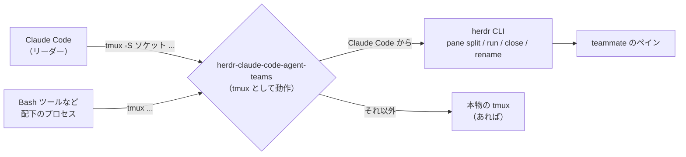
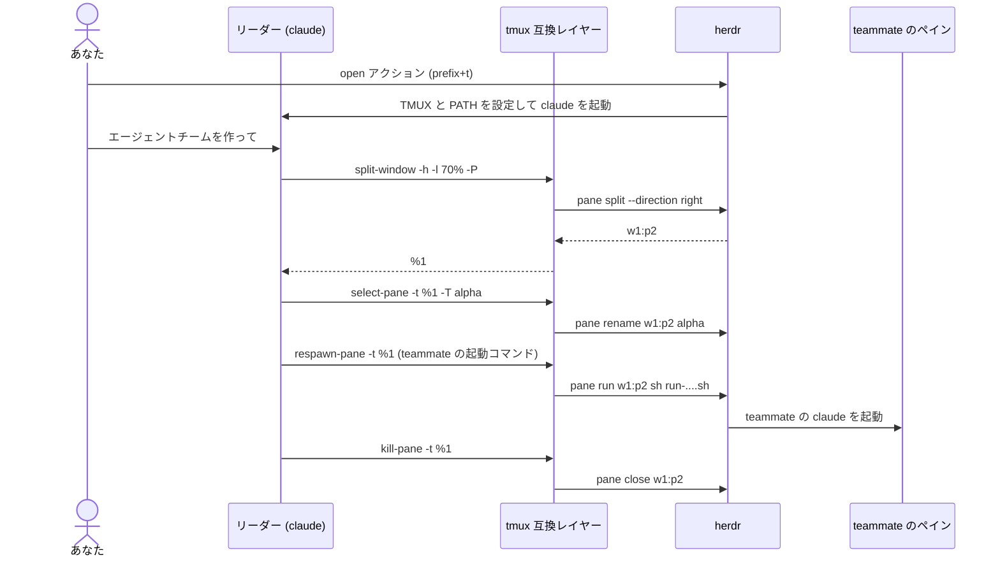

# herdr-claude-code-agent-teams

[English](README.md) | 日本語

[](https://github.com/kotarella1110/herdr-claude-code-agent-teams/actions/workflows/ci.yml)
[](LICENSE)

Claude Code の[エージェントチーム](https://code.claude.com/docs/en/agent-teams)で、teammate を [herdr](https://herdr.dev) のペインとして並べて動かす herdr プラグイン。

Claude Code は teammate を画面分割で並べる機能を tmux と iTerm2 でしか持たない。このプラグインは herdr の中で tmux を名乗るバイナリを差し込み、Claude Code が出す tmux の命令を `herdr pane` の操作に置き換える。teammate は herdr の普通のペインになるので、サイドバーで状態を一覧でき、名前もペイン枠に出る。

Claude Code と herdr の設定ファイルは書き換えない。エージェントチームを有効にする `CLAUDE_CODE_EXPERIMENTAL_AGENT_TEAMS=1` と `teammateMode: tmux` は、このプラグインから起動した `claude` にだけ渡す。

## 必要なもの

- herdr 0.9.5 以上
- エージェントチームが使える Claude Code（2.1.306 で確認）
- macOS または Linux

## インストール

```sh
herdr plugin install kotarella1110/herdr-claude-code-agent-teams
```

ビルド済みバイナリを GitHub Releases から取得し、SHA-256 を照合する。GitHub CLI（`gh`）にサインインしていれば、ビルド元の証明（provenance attestation）も検証する。ビルド済みバイナリがない環境では、`cargo` があればソースからビルドする。

`~/.config/herdr/config.toml` にキーを割り当てる。

```toml
[[keys.command]]
key = "prefix+t"
type = "plugin_action"
command = "kotarella1110.claude-code-agent-teams.open"
```

## 使い方

| アクション | 動き |
|---|---|
| `kotarella1110.claude-code-agent-teams.open` | 選択中のペインを右に分割し、そこでリーダーの Claude を起動する |
| `kotarella1110.claude-code-agent-teams.here` | 選択中のペインでリーダーの Claude を起動する。シェルが入力待ちのペインでなければ起動しない |
| `kotarella1110.claude-code-agent-teams.configure` | `claude` に渡す引数を、ポップアップのエディタで開く |
| `kotarella1110.claude-code-agent-teams.doctor` | 設定を確かめ、動いているリーダーをポップアップに一覧する |

起動したリーダーに「エージェントチームを作って、teammate は 2 人まで」のように頼むと、teammate がリーダーの右側に並ぶ。名前を付けないと Claude Code は手伝い役をペインを持たない普通のサブエージェントとして動かすので、プラグインはリーダーに短いシステムプロンプトを付け、手伝い役を名前付きの teammate として起動させる。teammate は作業を終えても続きの依頼を受けられるようにペインで待機し、リーダーが teammate を止めるとペインは閉じる。システムプロンプトで、用が済んだ teammate を止めるようリーダーに伝えている（「チームを片付けて」と頼んでもよい）。teammate が失敗したときは、原因を読めるようペインを残す。

### claude に渡す引数

`configure` アクションを実行し（キーに割り当ててもよい）、引数を 1 行で書く（例: `--model sonnet --advisor opus`）。`open` と `here` アクションはこれを `claude` に渡す。ポップアップのエディタは `$VISUAL` か `$EDITOR`、どちらもなければ `vi` を使う。

`~/.claude/settings.json` の `model` など、Claude Code 自身が読む設定はこれまでどおり効く。ここに書くのは、チームのリーダーにだけ付けたい引数だけでよい。

### 別のリポジトリで teammate を動かす

Claude Code は teammate を必ずリーダーと同じディレクトリで起動するため、teammate は別のリポジトリの `CLAUDE.md`、スキル、設定を読み込まない。このプラグインは、teammate の起動時に名前で行き先を決め、次の順に探したディレクトリで起動する。

1. リーダーがその名前に登録したディレクトリ。リーダーは teammate を起動する前に、Bash ツールで `<プラグインの実行ファイル> route <teammate の名前> <ディレクトリ>` を実行する。実行ファイルは `PATH` にないので、リーダーにはフルパスで伝える。登録はそのリーダーが動いている間だけ有効
2. リーダーのディレクトリの中にある、同じ名前の git リポジトリ
3. リーダーのディレクトリと同じ階層にある、同じ名前の git リポジトリ

Claude Code が名前の重複を避けて `api-2` のように番号を付けた場合は、番号を除いた名前で探す。シンボリックリンクは実体のパスに解決する。どれにも当たらない teammate は、これまでどおりリーダーと同じディレクトリで起動する。役割名がたまたま近くのリポジトリと同じ teammate（`frontend` サブモジュールの隣にいる `frontend` という名前のレビュー役など）も移動するが、リーダーにはその名前の一覧を伝えるので、避けた名前を付けられる。事前の設定は要らない。リーダーには起動時に、登録のしかたと、名前だけで使える近くのリポジトリを伝えるので、「api と web にまたがって作業して」と頼むだけでよい。いつも同じ場所を使いたいリポジトリは、`CLAUDE.md` に「api は ~/src/my-api にある」のように書いておけば、リーダーがそれを読んで登録する。`--append-system-prompt` か `--append-system-prompt-file` を自分で渡した場合は、この説明も上の teammate の起動の指示も付けないので、teammate に名前を付けることと `route` は自分でリーダーに伝える。

Claude Code で初めて開くディレクトリでは、teammate のペインにフォルダを信頼するかの確認が出るので、そのペインで答える。行き先を変えた記録は `calls.log` に `route` として残る。

### シェルから起動する

herdr のペインで `bin/herdr-claude-code-agent-teams` を直接実行しても同じように起動する。引数はそのまま `claude` に渡る。herdr の外で実行した場合は普通の `claude` として動く。

## 仕組み

1. 起動時に、本人だけが読める状態ディレクトリ `$XDG_STATE_HOME/herdr-claude-code-agent-teams/<サーバー>/<ペイン>-<pid>/`（`XDG_STATE_HOME` が未設定なら `~/.local/state`、権限 `0700`）を作る。`<サーバー>` は herdr のサーバーを識別する値、`<ペイン>` はペイン ID の `:` を `_` に置き換えたもの。その中の `bin/tmux` を自分自身へのシンボリックリンクにし、このディレクトリを `PATH` の先頭に置く
2. `TMUX` を状態ディレクトリ内のソケットのパスに向け、`TMUX_PANE=%0` を設定し、`--settings '{"teammateMode":"tmux"}'` と、自分で渡していなければ teammate の起動と振り分けの指示を書いた `--append-system-prompt` を付けて `claude` を起動する
3. Claude Code が `tmux split-window` などを呼ぶと、同じバイナリが tmux として動き、`herdr pane split` などに置き換えて tmux と同じ形式で答える



teammate を起動して終了させるまでの流れ:



tmux のペイン ID（`%1` など）と herdr のペイン ID の対応は `idmap.json` に保存する。teammate の起動コマンドは本人だけが読めるスクリプトに書き、スクリプトは実行開始時に自分を削除する。teammate が正常に終了するとペインは閉じる。

| tmux | herdr |
|---|---|
| `split-window` | `pane split` |
| `respawn-pane` | `pane run` |
| `kill-pane` | `pane close` |
| `select-pane -T` | `pane rename` |
| `list-panes` | `pane list`（チームのペインだけを返す） |
| `display-message -p` | `pane get` |
| `capture-pane` | `pane read` |
| `send-keys` | `pane send-text` / `pane send-keys` |

### 安全のための制限

これらはリーダーの Bash ツールで動くスクリプトが `tmux` を呼ぶような事故を防ぐためのもので、セキュリティの境界ではない。リーダー配下のプロセスはすべて herdr の環境変数を引き継いでおり、herdr を直接操作できる。

- ペインを変更できるのは、Claude Code のソケット（`-S`）を付けた呼び出しだけ。付いていない場合、参照だけの命令（`display-message`・`show-options`・`list-panes` など）とレイアウト調整のような何もしない命令はこのプラグインが答え、それ以外は本物の `tmux` があればそちらに渡し、なければ失敗する
- リーダー自身のペインを閉じたり、再起動したり、文字を打ち込んだりはしない
- 知らないフラグは推測せずにエラーにする
- 書き換えるのは、Claude Code が teammate の起動用に送るコマンドの先頭の `cd` だけで、行き先は存在するディレクトリに限る。リーダー配下のプロセスは `route` で行き先を登録できるが、これは herdr を直接操作できるのと同じ範囲に収まる

## 制約

- teammate ごとの枠の色と、`select-layout` による並べ方の指定は herdr に該当機能がないため無視する
- 同じディレクトリで起動した teammate は、同じ作業ツリーを使う（エージェントチームの仕様）。同じファイルを触らせない
- エージェントチームは Claude Code の実験機能なので、更新で tmux の使い方が変わると動かなくなることがある

## 動きを調べる

まず `doctor` アクションを使う。プラグインのディレクトリで `bin/herdr-claude-code-agent-teams doctor` を実行してもよい。herdr と Claude Code のバージョン、herdr の Claude Code 連携、ロケール、状態ディレクトリを確かめ、動いているリーダーごとに teammate のペイン、登録した行き先、対応できなかった tmux 命令を一覧する。確認に失敗した項目があると終了コード 1 で終わる。ポップアップは herdr サーバーの環境で動き、リーダーはシェルの環境で動くので、`claude`、ロケール、`XDG_STATE_HOME` をシェルの起動ファイルで設定している場合は、ペインでコマンドを実行する。herdr の中では、今の herdr サーバーのリーダーだけを一覧する。

リーダーごとに、受けた tmux 命令の種類・対象・終了コード・エラーを記録する。コマンドライン、打ち込んだ文字、画面の内容は記録しない。

```sh
tail -f ~/.local/state/herdr-claude-code-agent-teams/*/<ペイン>-*/calls.log
grep unhandled ~/.local/state/herdr-claude-code-agent-teams/*/*/calls.log
```

`unhandled` は Claude Code から届いた、対応していない tmux 命令。失敗を返すと Claude Code が teammate の起動をやめるため成功として返しているので、動きがおかしいときはここから調べる。

## 開発

```sh
cargo fmt --all --check
cargo clippy --all-targets --all-features -- -D warnings
cargo test
sh herdr/install.sh --source   # bin/ にビルドして配置
herdr plugin link .
```

結合テストは偽の `herdr` と `claude` を使い、実際の herdr なしで動く。

## リリース

[knope](https://knope.tech) の change file でリリースする。

1. 利用者に関わる変更を入れる PR で `knope document-change` を実行し、`major` / `minor` / `patch` を選んで概要を書く。生成された `.changeset/*.md` をコミットする。版が `0.x` の間、knope は `major` を次のマイナー版、`minor` と `patch` を次のパッチ版に上げる。
2. change file が `main` に入ると、`Prepare release` ワークフローが `chore: prepare release <version>` の PR を作る（既にあれば更新する）。この PR は `Cargo.toml`・`Cargo.lock`・`herdr-plugin.toml` の版番号を上げ、`CHANGELOG.md` にリリースノートを足す。
3. その PR をマージすると、macOS と Linux 向けのバイナリをビルドし、それを添付した `v<version>` の GitHub リリースを公開する。

リリース PR でも CI を動かすため、シークレット `RELEASE_TOKEN`（contents と pull requests の読み書き権限を持つ fine-grained token）を設定する。未設定の場合は `GITHUB_TOKEN` を使うが、リポジトリ設定の「Allow GitHub Actions to create and approve pull requests」を有効にする必要があり、リリース PR で CI は動かない。

`Release` ワークフローは `main` で手動実行もできる。現在の版番号のタグがまだなければ、その版をリリースする。初回リリースと、失敗したリリースのやり直しはこれで行う。

## コントリビュート

[CONTRIBUTING.md](CONTRIBUTING.md) を参照。セキュリティの問題は [SECURITY.md](SECURITY.md) の手順で報告する。

## ライセンス

MIT
