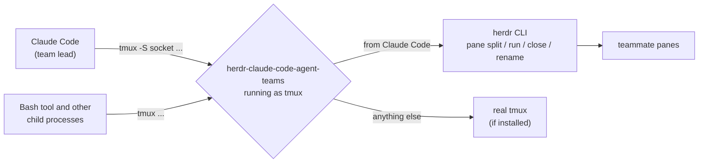
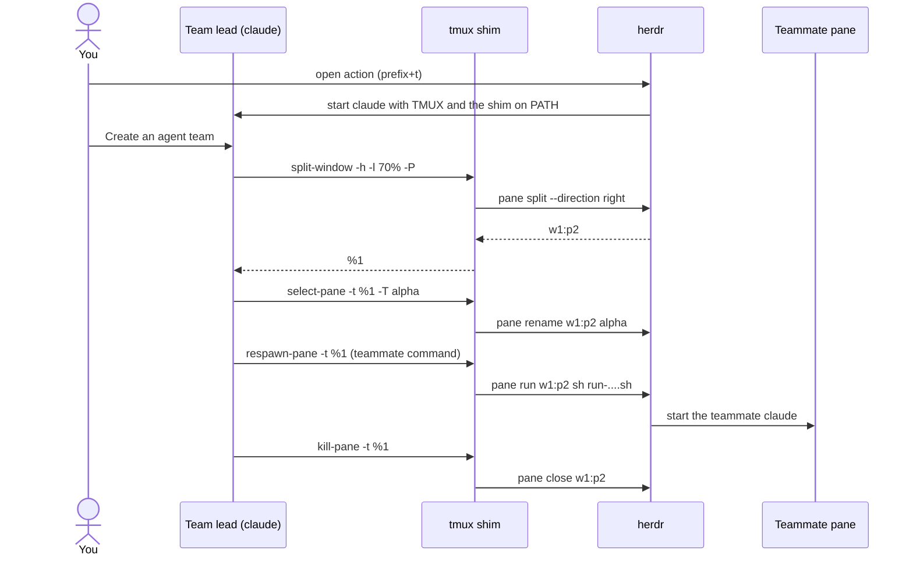

# herdr-claude-code-agent-teams

English | [日本語](README.ja.md)

[](https://github.com/kotarella1110/herdr-claude-code-agent-teams/actions/workflows/ci.yml)
[](LICENSE)

A [herdr](https://herdr.dev) plugin that runs the teammates of Claude Code [agent teams](https://code.claude.com/docs/en/agent-teams) as herdr panes.

Claude Code can only lay teammates out side by side in tmux or iTerm2. This plugin puts a binary that answers as `tmux` in front of Claude Code inside herdr, and translates the tmux commands Claude Code issues into `herdr pane` operations. Teammates become ordinary herdr panes: the sidebar shows their state, and their names appear on the pane borders.

It does not edit Claude Code or herdr configuration files. `CLAUDE_CODE_EXPERIMENTAL_AGENT_TEAMS=1` and `teammateMode: tmux` are passed only to the `claude` process this plugin starts.

## Requirements

- herdr 0.9.5 or later
- Claude Code with agent teams (tested with 2.1.306)
- macOS or Linux

## Install

```sh
herdr plugin install kotarella1110/herdr-claude-code-agent-teams
```

The install step downloads a prebuilt binary from GitHub Releases and checks its SHA-256. When the GitHub CLI (`gh`) is signed in, it also verifies the build provenance attestation. If no prebuilt binary is available and `cargo` is, it builds from source.

Bind a key in `~/.config/herdr/config.toml`:

```toml
[[keys.command]]
key = "prefix+t"
type = "plugin_action"
command = "kotarella1110.claude-code-agent-teams.open"
```

## Usage

| Action | What it does |
|---|---|
| `kotarella1110.claude-code-agent-teams.open` | Splits the focused pane to the right and starts a team lead Claude there |
| `kotarella1110.claude-code-agent-teams.here` | Starts a team lead Claude in the focused pane. Refuses unless the pane is at a shell prompt |
| `kotarella1110.claude-code-agent-teams.configure` | Opens the arguments passed to `claude` in your editor, in a popup |
| `kotarella1110.claude-code-agent-teams.doctor` | Checks the setup and lists running leads, in a popup |

Ask the lead something like "Create an agent team with at most two teammates", and the teammates appear to the right of the lead. The plugin appends a short system prompt telling the lead to spawn helpers as named teammates; without a name, Claude Code runs a helper as a background subagent that never gets a pane. A teammate stays idle in its pane after finishing a task so it can take follow-up work; the pane closes when the lead stops the teammate (the system prompt asks the lead to do so once a teammate is done, and "clean up the team" also works). A pane whose teammate fails stays open so you can read the error.

### Arguments for claude

Run the `configure` action (or bind it to a key) and write the arguments on one line, for example `--model sonnet --advisor opus`. The `open` and `here` actions pass them to `claude`. The popup uses `$VISUAL` or `$EDITOR`, falling back to `vi`.

Settings that Claude Code reads itself, such as `model` in `~/.claude/settings.json`, apply as usual, so you only need this for arguments you want just for team leads.

### Teammates in other repositories

Claude Code starts every teammate in the lead's directory, so a teammate never loads another repository's `CLAUDE.md`, skills or settings. This plugin moves a teammate into another directory, decided by its name when it starts:

1. A directory the lead registered for that name. Before spawning the teammate, the lead runs `<plugin binary> route <teammate-name> <directory>` with its Bash tool; the lead is given the binary's full path, since it is not on `PATH`. The registration lasts as long as the lead.
2. A git repository with that name inside the lead's directory.
3. A git repository with that name next to the lead's directory.

When Claude Code renames a teammate to avoid a clash, such as `api-2`, the name without the suffix is used. Symbolic links are resolved first. Any other teammate starts in the lead's directory as before. A teammate whose role name happens to match a nearby repository, for example a reviewer called `frontend` next to a `frontend` submodule, is moved there too; the lead is shown those names so it can avoid them. Nothing has to be set up in advance: when the lead starts, it is told how to register a directory and which nearby repositories it can use by name, so asking "work across api and web" is enough. To always use the same place for a repository, write it in `CLAUDE.md`, for example "api lives in ~/src/my-api", and the lead registers it. If you pass your own `--append-system-prompt` or `--append-system-prompt-file`, the plugin adds neither this nor the teammate instruction above, so tell the lead yourself to give each teammate a name and about `route`.

The first time Claude Code opens a directory, the teammate pane asks whether you trust the folder. Answer it in that pane. Each move is logged in `calls.log` as a `route` entry.

### Launch from a shell

Running `bin/herdr-claude-code-agent-teams` directly in a herdr pane works the same way; its arguments go to `claude` unchanged. Outside herdr it behaves as plain `claude`.

## How it works

1. On launch it creates a private state directory, `$XDG_STATE_HOME/herdr-claude-code-agent-teams/<server>/<pane>-<pid>/` (`~/.local/state` when `XDG_STATE_HOME` is unset, mode `0700`), where `<server>` identifies the herdr server and `<pane>` is the pane id with `:` replaced by `_`. Inside it, `bin/tmux` is a symlink to the binary itself, and that directory goes first in `PATH`.
2. It points `TMUX` at a socket path inside the state directory, sets `TMUX_PANE=%0`, and starts `claude` with `--settings '{"teammateMode":"tmux"}'` and, unless you pass your own, `--append-system-prompt` with the teammate and routing instructions.
3. When Claude Code calls `tmux split-window` and friends, the same binary runs as tmux, performs the matching `herdr pane` operation, and answers in tmux's format.



Starting a teammate and shutting it down:



The mapping between tmux pane ids (`%1`, ...) and herdr panes is kept in `idmap.json`. herdr gives a pane a new pane id when you move it to another workspace, so each pane is also remembered by its herdr terminal id, and a moved teammate keeps its tmux pane id and title. Moving the lead's own pane to another workspace is not supported: the teammates stay behind and Claude Code loses track of its window. A teammate command is written to a private script that deletes itself when it starts, and the pane closes when the teammate exits cleanly.

| tmux | herdr |
|---|---|
| `split-window` | `pane split` |
| `respawn-pane` | `pane run` |
| `kill-pane` | `pane close` |
| `select-pane -T` | `pane rename` |
| `list-panes` | `pane list` (team panes only) |
| `display-message -p` | `pane get` |
| `capture-pane` | `pane read` |
| `send-keys` | `pane send-text` / `pane send-keys` |

### Safety

These guard against accidents, such as a script that runs `tmux` inside the lead's Bash tool. They are not a security boundary: every process under the lead inherits herdr's own environment and can drive herdr directly.

- Only calls that carry Claude Code's socket (`-S`) can change panes. Without it, read-only queries (`display-message`, `show-options`, `list-panes` and the like) and the no-op layout commands are answered by this plugin, and everything else goes to the real `tmux` if one is installed, or fails.
- Commands never close, respawn or type into the team lead's own pane.
- Unknown flags are rejected instead of guessed.
- Only the leading `cd` of a launch command that Claude Code sends for a teammate is rewritten, and only to an existing directory. Any process under the lead can register a directory with `route`, the same way it can already drive herdr.

## Limitations

- Per-teammate border colors and `select-layout` are ignored because herdr has no equivalent.
- Teammates that start in the same directory share one working tree (that is how agent teams work). Do not let them edit the same files.
- Agent teams are experimental in Claude Code. A Claude Code update that changes how it drives tmux can break this plugin.

## Troubleshooting

Start with the `doctor` action, or run `bin/herdr-claude-code-agent-teams doctor` from the plugin directory. It checks the herdr and Claude Code versions, herdr's Claude Code integration, the locale and the state directory, and lists each running lead with its teammate panes, registered routes and any tmux commands it could not handle. It exits with status 1 when a check fails. The popup runs with the herdr server's environment, while leads run in your shell, so when `claude`, the locale or `XDG_STATE_HOME` come from your shell's startup files, run the command in a pane instead. Inside herdr it lists only the leads of the current herdr server.

Each lead logs the tmux commands it receives: the verb, the target, the exit status and any error. Command lines, typed text and screen contents are not logged.

```sh
tail -f ~/.local/state/herdr-claude-code-agent-teams/*/<pane>-*/calls.log
grep unhandled ~/.local/state/herdr-claude-code-agent-teams/*/*/calls.log
```

`unhandled` marks a tmux command from Claude Code that this plugin does not implement. Those commands report success, because Claude Code stops starting a teammate when one fails, so this log is the place to look when something misbehaves.

## Development

```sh
cargo fmt --all --check
cargo clippy --all-targets --all-features -- -D warnings
cargo test
sh herdr/install.sh --source   # build into bin/
herdr plugin link .
```

The integration tests use fake `herdr` and `claude` executables and need no running herdr.

## Release

Releases are driven by [knope](https://knope.tech) change files.

1. In each pull request with a user-facing change, run `knope document-change`, pick `major`, `minor` or `patch`, and write a summary. While the version is `0.x`, knope bumps `major` changes to the next minor version and `minor` or `patch` changes to the next patch version. Commit the generated `.changeset/*.md` file.
2. When change files land on `main`, the `Prepare release` workflow opens (or updates) a `chore: prepare release <version>` pull request that bumps `Cargo.toml`, `Cargo.lock` and `herdr-plugin.toml` and adds the release notes to `CHANGELOG.md`.
3. Merging that pull request builds the macOS and Linux binaries and publishes the `v<version>` GitHub release with them attached.

Set a `RELEASE_TOKEN` secret (a fine-grained token with read and write access to contents and pull requests) so that CI runs on the release pull request. Without it the workflow falls back to `GITHUB_TOKEN`, which needs "Allow GitHub Actions to create and approve pull requests" enabled and does not trigger CI on that pull request.

The `Release` workflow can also be run manually on `main`. It publishes the current version when its tag does not exist yet, which is how the first release and a retry after a failed release work.

## Contributing

See [CONTRIBUTING.md](CONTRIBUTING.md). Report security issues as described in [SECURITY.md](SECURITY.md).

## License

MIT
